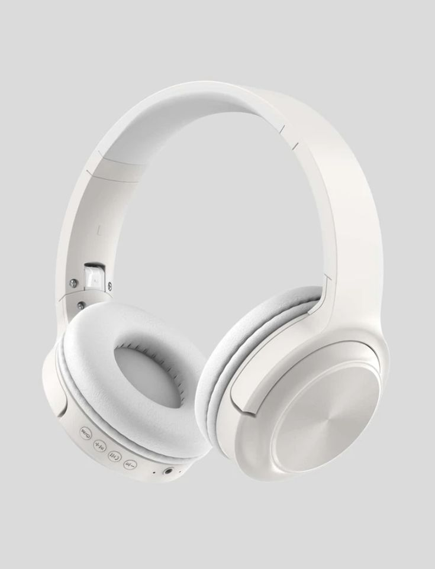

# AURIX ONE — Flagship Audio Website

> **"Silence the noise. Feel everything."**  
> A premium, dark, cinematic landing page for the fictional consumer electronics brand **AURIX**.



## Overview

AURIX ONE is an acoustic engineering landing page featuring:
- **Interactive 40-Frame Exploded View**: Smoothly deconstructs the headphone on hover/scrub into its 7 core acoustic layers using an HTML5 Canvas sequence and `requestAnimationFrame` lerp loop.
- **Real-Time DSP Waveform Oscilloscope**: Simulates active noise cancellation (phase inversion cancellation), spatial audio 360°, and transparency modes.
- **Cinematic 1080p Video Showcase**: Ambient hardware orbit presentation with custom controls.
- **Studio Specifications & Material Analysis**: Full acoustic measurements, transducer architecture, and material deep-dive.
- **Interactive Pre-Order Configurator**: Finish selection (Matte Obsidian vs. Titanium Silver) and reservation modal.

## Tech Stack

- **Framework**: [React 18](https://react.dev/) + [Vite 5](https://vitejs.dev/)
- **Language**: [TypeScript](https://www.typescriptlang.org/)
- **Styling**: [Tailwind CSS 3](https://tailwindcss.com/)
- **Design Intelligence**: UI/UX Pro Max System + 21st.dev Component Patterns
- **Icons**: [Lucide React](https://lucide.dev/)
- **Deployment Ready**: [Netlify](https://www.netlify.com/) (configured via `netlify.toml`)

## Getting Started

### 1. Install Dependencies
```bash
npm install
```

### 2. Run Development Server
```bash
npm run dev
```
Open [http://localhost:5173](http://localhost:5173) in your browser.

### 3. Build for Production
```bash
npm run build
```
Build output will be generated in `dist/`.

## Deploying to Netlify

This project is pre-configured with `netlify.toml` for 1-click deployment:
- **Build command**: `npm run build`
- **Publish directory**: `dist`
- **SPA redirect**: Enabled (`/* -> /index.html 200`)
